# argocd-applicationset-multicluster

[](https://github.com/ngems1/argocd-applicationset-multicluster/actions/workflows/ci.yml)


-success)
[](https://github.com/ngems1/code-clinic)

<p align="center"></p>

**One application, every cluster, in order.** An Argo CD **ApplicationSet** generates one
Application per registered cluster from the cluster's `code-clinic.io/env` label. Each
Application renders a **Kustomize overlay on top of the podinfo Helm chart**, so every
environment gets the same chart and image with its own differences (replicas, PDB, HPA,
resources). **RollingSync** rolls each change out dev → staging → prod, and the ApplicationSet
can never delete production by itself. Everything is proven on three local kind clusters.

## What you'll learn

- How an ApplicationSet's **clusters generator** turns "a labelled cluster secret" into "an
  Application with the right overlay", and why that beats copy-pasted Applications.
- The **Kustomize-on-Helm** pattern: Helm packages the app, Kustomize applies small,
  reviewable per-environment patches (including the one Helm values can't express).
- **Progressive delivery** with RollingSync, and its real cost: auto-sync and self-heal are
  switched off (verified, not assumed).
- The GitOps safety settings that keep a label typo from deleting prod
  (`applicationsSync: create-update`, `preserveResourcesOnDeletion`).
- **Least-privilege multi-cluster access**: namespace-scoped cluster credentials, an
  AppProject whitelist, restricted Pod Security.

## Problem

> Build an Argo CD ApplicationSet + Kustomize/Helm pattern that deploys the same application
> across multiple clusters/environments with environment-specific overlays.
> (Code Clinic challenge #9)

**Assumptions**

- One environment per cluster (dev, staging, prod). Several clusters can share an environment
  (two prod regions): the template and RollingSync's `maxUpdate: 1` already handle that.
- The application is [podinfo](https://github.com/stefanprodan/podinfo), a small, well-known
  demo app published as a Helm chart. Swap in your own chart; nothing else changes.
- Argo CD runs on a management cluster; here the dev cluster doubles as management cluster.
- Every environment tracks `main`; promotion order comes from RollingSync (ADR 0003).

## Architecture

```text
            Git (main)                          management cluster (cc-dev)
 apps/podinfo/base      ──helmCharts──►  ┌───────────────────────────────────────────┐
 apps/podinfo/overlays/{dev,staging,prod}│ Argo CD                                   │
 platform/appproject.yaml ─────────────► │  AppProject podinfo (repo, ns, 4 kinds)   │
 platform/applicationset.yaml ─────────► │  ApplicationSet podinfo                   │
                                         │    generator: clusters (env label)        │
 cluster secrets (env=dev|staging|prod)─►│    strategy: RollingSync dev→staging→prod │
                                         └──────┬──────────────┬──────────────┬──────┘
                                    podinfo-dev │  podinfo-staging │  podinfo-prod │
                                                ▼                  ▼               ▼
                                         cc-dev / podinfo   cc-staging / podinfo   cc-prod / podinfo
                                         1 replica          2 replicas + PDB       HPA 3-10 + PDB + spread
```

| Component | Path | Role |
|---|---|---|
| Helm-inflated base | [`apps/podinfo/base/`](apps/podinfo/base/) | podinfo chart 6.17.0 via `helmCharts:`, shared values (restricted security context, requests/limits), `skipTests: true` |
| Overlays | [`apps/podinfo/overlays/`](apps/podinfo/overlays/) | dev / staging / prod differences as patches and extra resources |
| AppProject | [`platform/appproject.yaml`](platform/appproject.yaml) | one source repo, one namespace on any cluster, 4 allowed kinds, no cluster-scoped kinds |
| ApplicationSet | [`platform/applicationset.yaml`](platform/applicationset.yaml) | clusters generator, Go templates with `missingkey=error`, RollingSync, never deletes |
| Cluster onboarding | [`clusters/onboarding.yaml`](clusters/onboarding.yaml) | namespace (restricted PSS) + a ServiceAccount limited to that namespace |
| Cluster secret example | [`clusters/cluster-secret.example.yaml`](clusters/cluster-secret.example.yaml) | how a cluster is registered: env label, namespace-scoped mode |
| Argo CD install | [`bootstrap/argocd/values.yaml`](bootstrap/argocd/values.yaml) | official chart 10.18.0 (Argo CD v3.6.1): progressive syncs on, `--enable-helm` |

## Prerequisites

- **For the static checks:** Python 3.12+, [uv](https://docs.astral.sh/uv/), kustomize 5.8+,
  helm, kubeconform. Or just open the **dev container / Codespaces** (image 1.1.0 has them all).
- **For the end-to-end test:** Docker with ~6 GB of free memory (three kind clusters + Argo CD).
- **For real clusters:** Argo CD 3.x on a management cluster, and `kubectl` access to each
  workload cluster for the one-time onboarding.

## Usage

**Try it locally (three kind clusters):**

```bash
make e2e-up     # ~10-15 min: clusters, Argo CD, git server, ApplicationSet, all checks
# explore: kubectl --kubeconfig .e2e/dev.kubeconfig -n argocd get applications
make e2e-down
```

**On real clusters:**

```bash
# 1. Argo CD on the management cluster (progressive syncs + --enable-helm)
helm upgrade --install argocd argo-cd --repo https://argoproj.github.io/argo-helm \
  --version 10.18.0 -n argocd --create-namespace -f bootstrap/argocd/values.yaml

# 2. Onboard each workload cluster (namespace + least-privilege ServiceAccount)
kubectl --context prod-eu-west-1 apply -k clusters

# 3. Register it: a Secret like clusters/cluster-secret.example.yaml, with env=prod
#    (delivered by External Secrets / Sealed Secrets, never committed)

# 4. The project and the ApplicationSet
kubectl --context mgmt -n argocd apply -k platform
```

From then on, a merge to `main` rolls out dev → staging → prod, and a new cluster is one
labelled cluster secret.

## Examples

| You want to | Do |
|---|---|
| see exactly what prod gets | `kustomize build --enable-helm apps/podinfo/overlays/prod` (or `make render`) |
| add a second prod region | register it with `code-clinic.io/env: prod`; RollingSync updates prod clusters one at a time |
| change something for every environment | edit `apps/podinfo/base/values.yaml` (rolls out in order) |
| change something for one environment | add or edit a patch in `apps/podinfo/overlays/<env>/` |
| add a new kind (e.g. a ConfigMap) | add it to the overlay **and** to `namespaceResourceWhitelist` in the AppProject (drill 3) |

## Configuration

| Setting | Where | Value | Why |
|---|---|---|---|
| `code-clinic.io/env` label | cluster secret | `dev` \| `staging` \| `prod` | selects the cluster and picks its overlay |
| `goTemplateOptions` | ApplicationSet | `missingkey=error` | a template typo fails instead of rendering `<no value>` |
| `strategy.rollingSync.steps` | ApplicationSet | dev, staging, prod (`maxUpdate: 1`) | ordering and blast radius |
| `applicationsSync` | ApplicationSet | `create-update` | never delete an Application automatically |
| `preserveResourcesOnDeletion` | ApplicationSet | `true` | deleting an Application keeps what it deployed |
| `namespaces` / `clusterResources` | cluster secret | `podinfo` / `"false"` | Argo CD watches and manages one namespace only |
| `applicationsetcontroller.enable.progressive.syncs` | Argo CD values | `true` | RollingSync is behind this flag |
| `kustomize.buildOptions` | Argo CD values | `--enable-helm` | the base inflates a Helm chart |
| chart version | `apps/podinfo/base/kustomization.yaml` | 6.17.0 | one artifact for every environment |

## 💰 Cost

| Item | Monthly cost |
|---|---|
| Local lab: three kind clusters + Argo CD on your Docker | $0 |
| CI (GitHub-hosted runners, public repo) | $0 |
| **On a cloud** (not created by this repo; rough on-demand figures): 3 small managed clusters, e.g. EKS control plane $73 each + 2 × t3.medium nodes (~$60) each | ≈ $400 |

The lab costs nothing; the cloud line is there so you know what "three clusters" means in a
budget (a shared non-prod cluster for dev and staging is the usual first saving).

## 🧹 Cleanup / teardown

```bash
make e2e-down            # deletes the three kind clusters and .e2e/
rm -rf rendered apps/podinfo/base/charts   # rendered output and the downloaded chart
```

Not removed automatically: the kind node image (`kindest/node:v1.37.0`, ~1 GB) and pulled
images in Docker (`docker image prune`). On real clusters, because of ADR 0004, **deleting the
ApplicationSet removes nothing**: delete each Application, then the `podinfo` namespace, then
the cluster secret and the `argocd-manager` ServiceAccount, on purpose.

## 🏠 Run it locally for free

`make e2e` (or `make e2e-up` to keep the clusters) runs [`tests/e2e/run.sh`](tests/e2e/run.sh)
inside the course image with your Docker socket. It creates `cc-dev` (Argo CD + dev),
`cc-staging` and `cc-prod` (with metrics-server so the HPA works), onboards them with the real
`clusters/onboarding.yaml`, serves **this repository's HEAD** from a git daemon inside `cc-dev`
(nothing needs to be pushed), applies the real `platform/` manifests, and checks:

1. one Application per labelled cluster, Synced + Healthy, each running its own overlay;
2. a commit to the base reaches **dev, then staging, then prod** (RollingSync order);
3. a manual `kubectl scale` is **detected** (OutOfSync), **not** reverted (RollingSync turns
   auto-sync off), and a sync restores Git's state;
4. removing the env label from the prod cluster **keeps** `podinfo-prod` and its pods.

No cloud account, no cost. The static checks (`make all`) need no cluster at all.

## Security considerations

See [docs/THREAT-MODEL.md](docs/THREAT-MODEL.md). Highlights:

- **Argo CD never gets cluster-admin** on workload clusters: a ServiceAccount with `admin` in
  the `podinfo` namespace and read access there, nothing cluster-wide; the cluster secret runs
  in namespace-scoped mode.
- The **AppProject** allows one repository, one namespace and four kinds; no cluster-scoped
  resources at all. The application can't widen its own permissions.
- Pods run under the **restricted Pod Security Standard** (enforced on the namespace).
- Cluster secrets contain credentials: deliver them with External Secrets or Sealed Secrets;
  in production use short-lived credentials (EKS `awsAuthConfig`, workload identity).
- `main` is the production deploy button: protect it.

## Idempotency notes

Everything is declarative and converges: re-applying `platform/` or `clusters/` changes
nothing; re-running the e2e reuses existing clusters (`KEEP=1`) and re-installs Argo CD with
`helm upgrade --install`. The ApplicationSet regenerates the same Applications from the same
cluster secrets. The one non-idempotent operation is deliberate: removing a cluster is a
manual runbook (ADR 0004).

## Running this in production

**Signals to watch**

| Signal | Source | Alert when |
|---|---|---|
| Application sync / health | `argocd_app_info{sync_status,health_status}` | any prod app not Synced+Healthy for 15 min |
| Drift | `argocd_app_info{sync_status="OutOfSync"}` | OutOfSync for 15 min (RollingSync won't self-heal) |
| Rollout stuck | ApplicationSet `.status.applicationStatus[*].status` | a step `Waiting`/`Pending` for 30 min |
| Generator errors | ApplicationSet condition `ErrorOccurred` | any |
| Cluster connectivity | `argocd_cluster_connection_status` | a cluster down for 5 min |

**Runbook**

1. *A bad change is rolling out.* Revert the commit on `main`. RollingSync rolls the revert out
   in the same order; prod never received the bad change if dev or staging turned unhealthy.
   To freeze everything, scale the ApplicationSet controller to 0 (Applications keep running).
2. *An Application is stuck "Unknown" / ComparisonError "forbidden".* The cluster credential
   lacks a permission (see the e2e finding in the CHANGELOG): check the onboarding RBAC.
3. *A cluster lost its label / an Application looks orphaned.* Nothing was deleted (ADR 0004):
   restore the label; delete the Application only if the cluster is really gone.

**Rolling back** is a Git revert. To pin prod to a known revision during an incident, set
`targetRevision` for prod only (a `templatePatch`) and remove it afterwards.

## Testing

```bash
make all     # lint + test + validate + security + docs (no cluster, ~1 min)
make e2e     # three kind clusters + Argo CD (Docker, ~10-15 min)
```

- **45 static tests** on the rendered overlays and the platform manifests: kinds per
  environment, one pinned image everywhere, restricted security context, PDB below the replica
  floor, prod without `replicas` (HPA), every kind allowed by the AppProject, the template
  rendering to an existing overlay for each environment, the safety settings.
- **kubeconform** (strict, Kubernetes 1.33 / 1.35 / 1.37, Argo CD CRD schemas included) and
  **trivy config** (HIGH/CRITICAL) on everything that's rendered.
- **e2e** on three kind clusters, as described above.

## CI checks

| Job | Runs |
|---|---|
| `repo` (hub) | gitleaks, actionlint, course self-check |
| `kustomize` (hub) | `kustomize build --enable-helm` of the 3 overlays, `platform/`, `clusters/`; kubeconform on 3 Kubernetes versions |
| `shell` (hub) | ShellCheck on the e2e scripts |
| `static tests · trivy config` | ruff, mypy, 45 pytest tests, trivy config on the rendered overlays |
| `e2e on 3 kind clusters` | `tests/e2e/run.sh` on the runner; diagnostics dumped on failure |

Weekly scheduled run: a new chart, Argo CD or Kubernetes release breaks it here first.

## Repository layout

```text
apps/podinfo/base/        Helm chart via helmCharts + shared values
apps/podinfo/overlays/    dev, staging, prod
platform/                 AppProject + ApplicationSet (kubectl apply -k platform)
clusters/                 onboarding (per workload cluster) + cluster secret example
bootstrap/argocd/         Argo CD Helm values
tests/                    static pytest suite; e2e/ (kind) with pinned versions
docs/                     LEARN.md · DRILLS.md · THREAT-MODEL.md · adr/ · images/ · REVIEW-EXERCISE-ANSWERS.md
```

Learn the concepts in [docs/LEARN.md](docs/LEARN.md), break things with
[docs/DRILLS.md](docs/DRILLS.md), review a pull request like a senior with
[docs/REVIEW-EXERCISE-ANSWERS.md](docs/REVIEW-EXERCISE-ANSWERS.md) (branch `review-exercise`),
and read the trade-offs in [docs/adr/](docs/adr/). Part of the
[Code Clinic course](https://github.com/ngems1/code-clinic).

## License

[MIT](LICENSE) © ngems1
# argocd-applicationset-multicluster

